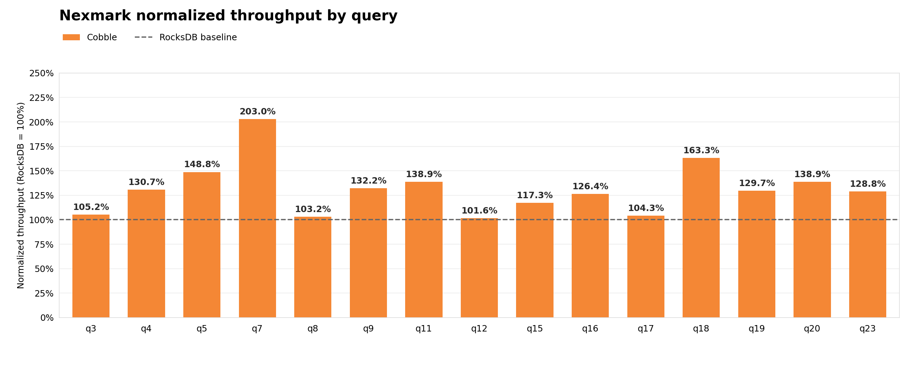
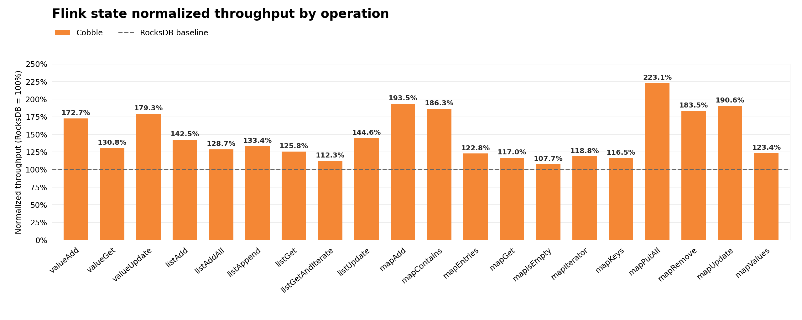

# Benchmark

This page compares Cobble and RocksDB as Flink state backends using Nexmark for
end-to-end streaming throughput, the Flink state micro-benchmark for isolated
state operations, and a remote checkpoint rescale benchmark.

All results were produced from a single local machine (Apple Silicon, macOS,
32 GiB RAM, 10 cores) with matching resource budgets for both backends.
The comparison is directional; absolute numbers depend on hardware and
workload.

For these comparisons, throughput differences within ±5% are treated as
run-to-run variation rather than a performance advantage or regression.

## Test setup

| Item | Value              |
|---|--------------------|
| Cobble version | 0.5.1-1-flink-1.17 |
| Flink | 1.17.2             |
| Java | OpenJDK 11.0.29    |

Both backends receive the same Flink managed-memory budget, without a
fixed-per-slot override. This does not imply equal total process memory.
Benchmark runs were sequential, without profiling. The remote rescale results
below are from an earlier version, identified in that section.

## Nexmark streaming benchmark

[Nexmark](https://github.com/nexmark/nexmark) is a streaming benchmark that
generates a synthetic stream of auction events (persons, auctions, bids) and
runs SQL queries against it. We use it to measure end-to-end pipeline
throughput under realistic stateful workloads.

### Configuration

| Item | Value |
|---|---|
| Events per run | 15,000,000 |
| Source rate ceiling | 10,000,000 events/s |
| Parallelism | 1 |
| TaskManager slots | 1 |
| Checkpointing | disabled |
| Sink | Nexmark blackhole |
| JobManager / TaskManager memory | 8 GiB each |
| State TTL | 24 h (both backends, `table.exec.state.ttl`) |
| Generator seed | fixed per round (1001, 2002, 3003) |
| Base event time | fixed (`2024-01-01 00:00:00 UTC`) |
| Queries | q3, q4, q5, q7, q8, q9, q11, q12, q15, q16, q17, q18, q19, q20, q23 |

To make the comparison reproducible, the Nexmark source was patched to
accept a fixed `generator.seed` and `base.time`. Each round runs with a
different fixed seed (1001, 2002, 3003) so the three rounds exercise
distinct event streams with deterministic input generation. A 24 h state TTL
(`table.exec.state.ttl`) is applied identically to both backends; Cobble honors
it natively via per-write expiry. Durations are three-seed arithmetic means.

### Results

The "Cobble throughput" column is `(RocksDB duration / Cobble duration - 1) * 100%`;
a positive value means Cobble finished faster.

| Query | RocksDB duration | Cobble duration | Cobble throughput |
|---|---:|---:|---:|
| q3 | 29.41s | 27.96s | +5.2% |
| q4 | 126.26s | 96.61s | +30.7% |
| q5 | 99.56s | 66.92s | +48.8% |
| q7 | 183.88s | 90.58s | +103.0% |
| q8 | 28.51s | 27.64s | +3.2% |
| q9 | 242.08s | 183.11s | +32.2% |
| q11 | 107.85s | 77.66s | +38.9% |
| q12 | 32.69s | 32.16s | +1.6% |
| q15 | 92.13s | 78.54s | +17.3% |
| q16 | 311.83s | 246.73s | +26.4% |
| q17 | 40.56s | 38.90s | +4.3% |
| q18 | 76.66s | 46.95s | +63.3% |
| q19 | 64.04s | 49.37s | +29.7% |
| q20 | 155.86s | 112.23s | +38.9% |
| q23 | 289.62s | 224.84s | +28.8% |
| **Sum of reported durations** | **1880.94s** | **1400.20s** | **+34.3%** |

Ratios and totals are calculated before rounding. The total sums the reported
per-query durations, rather than the elapsed time of all runs.

### Summary

- Cobble's reported throughput is more than 5% higher in **12 of 15** queries;
  the rest are within the variation range.
- The sum of Cobble reported durations is **25.6% lower** than RocksDB
  (1400.20s vs 1880.94s), a **+34.3%** throughput advantage.
- The largest Cobble lead is on **q7** (+103.0%). These are descriptive
  comparisons, not statistical significance claims.

## Flink state micro-benchmark

The `cobble-state-bench` module is a JMH in-process benchmark that measures
individual state operation throughput (ValueState, ListState, MapState) in
isolation, without a running Flink cluster. It is the Flink community's state
benchmark adapted to compare Cobble and RocksDB directly.

### Configuration

| Item | Value |
|---|---|
| JMH mode | Throughput |
| Unit | operations/ms |
| Threads | 1 |
| Warmup | 10 iterations, 1 second each |
| Measurement | 10 iterations, 1 second each |
| Forks | 3 |
| Backends | RocksDB, Cobble |
| Managed memory | 256 MiB (both backends, fraction 1.0) |
| Fixed-per-slot memory | none |
| JVM heap | not set |
| Initial keys | 500,000; MapState has 10 entries per key |

### Results

The "Cobble throughput" column is `(Cobble score / RocksDB score - 1) * 100%`;
a positive value means Cobble has higher throughput.

| Benchmark | RocksDB | Cobble | Cobble throughput |
|---|---:|---:|---:|
| valueAdd | 676.361 ± 37.824 | 1168.351 ± 31.878 | +72.7% |
| valueGet | 963.409 ± 19.816 | 1260.357 ± 10.267 | +30.8% |
| valueUpdate | 648.468 ± 47.373 | 1162.484 ± 24.702 | +79.3% |
| listAdd | 793.026 ± 16.335 | 1129.868 ± 31.271 | +42.5% |
| listAddAll | 520.504 ± 6.386 | 669.967 ± 6.128 | +28.7% |
| listAppend | 796.281 ± 15.366 | 1062.016 ± 23.257 | +33.4% |
| listGet | 737.045 ± 22.711 | 927.305 ± 15.764 | +25.8% |
| listGetAndIterate | 761.255 ± 7.721 | 854.880 ± 19.905 | +12.3% |
| listUpdate | 809.581 ± 20.381 | 1171.050 ± 26.295 | +44.6% |
| mapAdd | 643.396 ± 45.528 | 1245.213 ± 29.830 | +93.5% |
| mapContains | 395.154 ± 7.149 | 736.280 ± 13.616 | +86.3% |
| mapEntries | 1003.894 ± 30.295 | 1232.931 ± 11.051 | +22.8% |
| mapGet | 444.150 ± 5.097 | 519.460 ± 9.919 | +17.0% |
| mapIsEmpty | 264.989 ± 33.246 | 285.269 ± 4.550 | +7.7% |
| mapIterator | 1011.521 ± 29.808 | 1201.685 ± 42.897 | +18.8% |
| mapKeys | 1026.598 ± 28.847 | 1196.419 ± 57.187 | +16.5% |
| mapPutAll | 112.840 ± 6.943 | 251.707 ± 2.088 | +123.1% |
| mapRemove | 748.211 ± 48.058 | 1372.664 ± 36.048 | +83.5% |
| mapUpdate | 641.250 ± 50.624 | 1222.101 ± 27.334 | +90.6% |
| mapValues | 1015.741 ± 27.250 | 1253.163 ± 64.236 | +23.4% |

### Summary

- Cobble's mean throughput is more than 5% higher in **all 20** benchmarks.
- The largest Cobble leads are on **mapPutAll** (+123.1%), **mapAdd** (+93.5%),
  and **mapUpdate** (+90.6%).
- These comparisons describe sample means, not formal statistical
  significance tests.

## Remote rescale benchmark

This benchmark measures Flink-native checkpoint rescaling against an
S3-compatible object store with added network latency. An unbounded WordCount
job initializes a fixed 4 GiB keyspace and then updates it without a source
rate limit. The keyspace is unchanged by parallelism.

### Configuration

| Item | Value |
|---|---|
| Cobble version | 0.3.0-1-flink-1.17 (validated at 0.4.0-1) |
| Flink | 1.17.2 |
| State | 524,288 keys, 8 KiB payload per key (4 GiB configured) |
| Object store | RustFS through Toxiproxy |
| Added object-store latency | 40 ± 5 ms in each direction |
| Aggregate restore bandwidth | 1,000 Mbit/s across all connections |
| Restore mode | native checkpoint, claim |
| Parallelism | 2 to 3, then 3 to 2 |
| Resources per subtask | 1 slot, 1 CPU, 512 MiB managed memory |
| TaskManager process memory | 2 GiB per subtask |
| Source rate limit | none |
| Execution order | RocksDB and Cobble run sequentially |

Parallelism 2 uses two one-slot TaskManagers; parallelism 3 uses three. The
total resources therefore scale in the same 2:3 ratio as the job.

Restore time is measured from submission until every job subtask reports
`RUNNING` through the Flink REST lifecycle API. A job-level `RUNNING` state is
not sufficient while any subtask remains `INITIALIZING`. The aggregate
bandwidth limit is enabled immediately before each restore submission and
removed after all subtasks reach `RUNNING`.

### Results

| Backend | 2 to 3 restore | 3 to 2 restore |
|---|---:|---:|
| RocksDB | 75.214s | 84.392s |
| Cobble | 11.172s | 10.960s |

Cobble reached `RUNNING` 6.73 times faster for scale-out and 7.70 times faster
for scale-in. The traffic shaper recorded the following aggregate bytes sent
by the object-store proxy while each restore was bandwidth-limited:

| Backend | 2 to 3 proxy bytes | 3 to 2 proxy bytes |
|---|---:|---:|
| RocksDB | 8.71 GB | 9.72 GB |
| Cobble | 0.96 GB | 0.94 GB |

Each traffic-shaper record reported a `1 Gbit` rate and nonzero traffic.
Cobble restored rescaled state files by reference instead of downloading the
complete state before startup.

The first 30-second throughput sample did not advance for either backend, so it
is excluded rather than treated as a zero-throughput result. Later windows show
that both jobs resumed processing:

| Backend | 2 to 3, 30-60s | 2 to 3, 120-180s | 3 to 2, 30-60s | 3 to 2, 120-180s |
|---|---:|---:|---:|---:|
| RocksDB | 1,275,678 events/s | 1,276,797 events/s | 830,462 events/s | 828,329 events/s |
| Cobble | 1,266,066 events/s | 1,666,907 events/s | 977,647 events/s | 1,129,954 events/s |

## Observations

The Nexmark and state micro-benchmark results show Cobble delivering higher
throughput than RocksDB under the same managed-memory budget:

- **Write-heavy operations** (valueAdd, valueUpdate, mapAdd, mapPutAll,
  mapUpdate, mapRemove) show the largest Cobble advantages in the micro-benchmark, and
  the stateful Nexmark queries (q4, q5, q7, q18, q20) show the largest
  end-to-end gains.
- **Map reads and iteration** show higher mean throughput with Cobble:
  mapGet is +17.0%, and mapEntries, mapIterator, mapKeys, and mapValues are
  +16.5% to +23.4%.
- The remote rescale benchmark shows a separate tradeoff: restoring shared
  files by reference substantially reduces time to `RUNNING`, while a cold
  random-read workload can remain limited by remote-storage latency until its
  working set is cached or materialized locally.

These results reflect the configurations documented above.
Production performance depends on workload characteristics,
state size, hardware, and Flink configuration.
